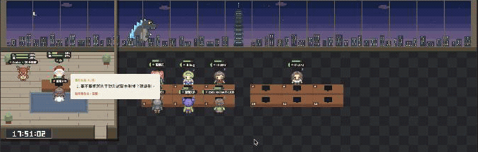

# Session Office

[中文說明](README.zh-TW.md)



A pixel-art office for your Claude Code sessions. Every running session sits at
a desk; when it finishes a turn it walks over to your desk to report. From the
page you can reply, acknowledge, `/clear`, `/compact`, rename it,
end it, or open a new session. For bigger work, open a project: a lead plans it,
hires member sessions and brings back only what is stuck and what you must decide.

What changed in each release: [CHANGELOG.md](CHANGELOG.md).

## How it works

```
session ─(office mod)→ ~/.claude/office/desks/<id>.json
                                   │
              bridge session (one, in its own iTerm2 tab)
                                   │ ArtifactData
                                   ▼
                    Session Office page (a claude.ai artifact)
```

- **mod/** — a Claude Code mod. Every session writes its desk card to a local
  file; work sessions never call a tool, so they stay in whatever permission
  mode you use.
- **The bridge** — one session started with `CLAUDE_OFFICE_BRIDGE=1` copies the
  desk cards into the page's database and brings instructions from the page
  back as files. It runs with `--dangerously-skip-permissions` (the
  artifact-data consent cannot be pre-approved otherwise), so **never type work
  into the bridge tab**. The light in the page's header shows when it last
  synced, and turns red when it is down; when it is your own network that is
  down, it says so instead, and the page reconnects by itself.
- **page/** — the artifact page itself.
- **install/** — the watchdog that keeps the bridge running, its LaunchAgent, and
  `office-hook.sh`: two hooks the installer adds to `~/.claude/settings.json`
  (a backup is kept next to it) that tell the page when a session waits on a
  permission dialog, and what background work is still running when a turn
  ends; a mod's own hook on those events can be cut off by other plugins.

## User manual

A picture-led manual in Traditional Chinese: <https://jacobintern.github.io/session-office/manual/>
(GitHub Pages; the source is [docs/manual/](docs/manual/), and a push to main
updates it within minutes).

## Token cost

About US$2 a month (estimated): syncing and desk cards run in the mod without
any model turn; what costs tokens is the report-format note added to each
prompt (~350 tokens), and in project teams the role rules, sent once per
session.
See [docs/token-cost.md](docs/token-cost.md).

## Before you start

| | needed | paid? | check |
|---|---|---|---|
| macOS + [iTerm2](https://iterm2.com) | yes | free | the bridge runs in an iTerm2 tab, kept alive by launchd |
| A claude.ai plan with Claude Code: Pro, Max, Ultra, Team or Enterprise | yes | **paid** — the Free plan has no Claude Code, no artifact database (`db`), and cannot publish from Claude Code | `claude --version` (tested on 2.1.311) |
| Pipoya's sprite pack + node | yes, once | free (the pack may not be redistributed) | see *Sprites* |
| Jira Cloud API token | no | your own Jira account | for the Jira column |
| Codex CLI | no | your own ChatGPT plan with Codex | for the Codex secretary |

Running it costs under US$1 a month on your plan (see *Token cost*); the
English tutor runs on the usage of whoever opens the page, never yours.

`install/install.sh --check` checks all of this (and the bridge) and prints the
fix for anything that fails.

## Install

1. Get the repository and install the mod:

   ```sh
   git clone git@github.com:jacobintern/session-office.git && cd session-office
   claude plugin marketplace add jacobintern/session-office
   claude plugin install office@session-office
   ```

2. Build the sprites (see *Sprites*):

   ```sh
   node install/build-sprites.mjs ~/Downloads/"PIPOYA FREE RPG Character Sprites 32x32.zip"
   ```

3. Publish your own copy of the page. Everyone needs their own: the page's
   database holds your sessions. In a Claude Code session started in this
   folder, paste:

   > Publish `page/session-office.html` as a new artifact with the `db`,
   > `user` and `sample` capabilities, and publish every file in `page/chars/` alongside it
   > at `chars/<file name>`. Give me the artifact's URL.

4. Run the installer, then put the URL in the config:

   ```sh
   ./install/install.sh          # --no-launchd to skip the LaunchAgent, --uninstall to remove it
   $EDITOR ~/.claude/office/config.json
   ```

5. Wait for the bridge (nothing to start by hand). Within a minute the watchdog opens an iTerm2 tab running
   the bridge. The first time, macOS and Claude Code ask three things; the
   bridge stays down until all three are answered:
   - macOS: allow the watchdog to control iTerm2 (Automation);
   - Claude Code: accept `--dangerously-skip-permissions`;
   - Claude Code: trust the bridge's folder (`bridgeCwd`).

   From then on the watchdog keeps the bridge up without you: it launches iTerm2 when it is not
   running (after a reboot), and replaces a bridge that has not synced for 3 minutes (stuck on a dialog).

6. Check: `./install/install.sh --check` in a shell, or `/office doctor` in any
   session. Then open a new `claude` session: it shows up at a desk on the page.

## Updating

After `git pull`, each part updates on its own:

| what changed | how to update |
|---|---|
| `mod/` (the office mod) | `claude plugin update office@session-office`, then restart your sessions and the bridge tab (close it; the watchdog reopens one within a minute). If `CLAUDE_CODE_PLUGIN_DIRS` points at this repository's `mod/`, restarting the sessions is enough |
| `page/` (the page) | in a session started in this folder, ask it to publish `page/session-office.html` to your existing URL (`officeUrl`); the database and the sprites stay |
| `install/` (watchdog, hook) | run `./install/install.sh` again; an existing `config.json` is kept |

## Commands

| | |
|---|---|
| `/office` | the page's link, this session's desk, and whether the setup checks pass |
| `/office doctor` | checks the config, this session's desk card, the bridge, and whether this mod's hooks ran (a plugin of a higher tier can skip them) |
| `/office name <text>` | the desk's nameplate (empty clears it); the session title follows (it runs `/rename`, and `/rename` in turn sets the nameplate). You can also type it in the page's reply box, or ask the session to rename itself |
| `/office project <text>` | the project / topic this desk belongs to (empty goes back to the branch ticket or the repo); sessions of one project share a board. The page's ✎ next to "Project" does the same |
| `/office status` | the bridge's last round |
| `/office bridge` / `/office bridge off` | make this session the bridge, or stop |

Every session runs the same checks 15 seconds after it starts and shows a
one-line notice only when one fails.

## Configuration — `~/.claude/office/config.json`

| key | meaning |
|---|---|
| `officeUrl` | your published page |
| `bridgeCwd` | the folder the bridge session runs in |
| `jira` | `null`, or `{ "site", "email", "jql"?, "tokenFile"? }` — the token is read from `tokenFile` (default `~/.jira_api_token`) and passed to curl on stdin, never on argv; without `jira` the column is hidden |
| `codex` | `false` hides the Codex secretary and its questions |
| `tutor` | `false` hides the English tutor |
| `analyst` | `false` hides the usage analyst |
| `city` | `{ "lat", "lng" }` for sunrise and sunset outside the window |
| `newSessionDirs` | folders offered when opening a new session from the page |
| `language` | `"zh-TW"` (default) or `"en"`: the heading sessions use for decisions (`## 要你決定` / `## Decisions for you`). The page itself follows the browser's language, with a 中 / EN switch in the header |

Only `jira.site`, `codex`, `tutor`, `analyst`, `city` and `newSessionDirs` reach the page (as
`meta/config`); the Jira email and token stay on your machine.

## Sprites

Characters come from Pipoya's free pack, **PIPOYA FREE RPG Character Sprites
32x32** (https://pipoya.itch.io/pipoya-free-rpg-character-sprites-32x32). Its
license allows use and editing but not redistribution, so the images are not
in this repository. Download the pack (free, from the link above), then build
the page's sprites from it with `install/build-sprites.mjs` (Install, step 2). This writes `page/chars/` (you, the Codex secretary, and four character
pools); publish those files together with the page.

## English tutor

The teacher at her own desk below your office translates what you paste,
paragraph by paragraph, original beside translation: Chinese into English, and
anything else into Traditional Chinese. Ask her about a translation, or how to
say something, with “Ask”. She asks Claude from the page itself (the `sample`
capability, on your own claude.ai usage), so she works without the bridge; the
first time, claude.ai asks you to allow it.

## Usage analyst

Click yourself to see what is left of your 5-hour and weekly limits and when
each resets. The analyst at the desk next to the tutor's goes further: from the
bridge's usage history (`meta/usage`, a reading a minute, kept 8 days) she
forecasts when each limit runs out at the recent rate, lists the live sessions
by cost, and answers questions about it, asking Claude the same way the tutor does.

## Asking Codex

Click the Codex secretary (on a phone, 問 Codex above the list) to ask Codex a
question about a folder. The page writes it to `codexAsks`; the bridge runs
`codex exec` read-only in that folder in the background (no terminal tab opens)
and writes the answer back. A follow-up in the same folder resumes the same Codex
thread until you press 新對話. One question runs at a time, for up to 10 minutes;
停止 ends it. Answers are cleared after three days.

## Project teams

Pick 專案 (project) in the page's 新開 form, give a goal, limits, a folder and a
member limit (3 by default), and you get a **lead** session:

- The lead plans first (tasks, scope, order, what it decides itself) and hires
  no one until you approve the plan. It then opens **members** with its `hire`
  tool and gives each a dispatch: a role (build, verify, look up), the scope and
  when it is done. Whoever built something never verifies it.
- You talk only to the lead. A question a member leaves in its own report is
  forwarded to the lead. An item the lead ends with `→ <member desk>` sends your
  answer straight into that member's session, as your own words.
- Each project has a task list (the `task` tool) and a row in the overview above
  the roster: how far it is, where it is stuck, the questions waiting on you,
  and the to-dos only you can do at the computer.
- The lead keeps its decisions and members' proven findings in the project's
  handoff file (`~/.claude/office/handoffs/<project>.md`). It is told when its
  own conversation passes 30% of its window, and when a member's passes 60%, so
  the work moves to a fresh session before it gets slow and costly.
- 收尾 (wrap up) in the overview asks the lead to take stock, hand off what is
  left, run a retrospective and dismiss the members.

## Report format

The mod adds a note to every prompt asking the model to end its answer with a
`## 要你決定` (decisions for you) section when it needs your input: one numbered
question per item, its options as (a) (b) (c), the recommended one marked
（建議）. The page shows that section as its own block. Answer by number
(`1. a 2. b`); a lone question takes a bare letter. Questions you have not
answered stay open item by item until you do, and a report you have not seen is
kept above the newest one until you open it. Things only you can do at the
computer are listed as to-dos tagged 〔等你・電腦〕 instead.

## License

MIT for the code in this repository. The character sprites are Pipoya's and
follow Pipoya's own terms.
