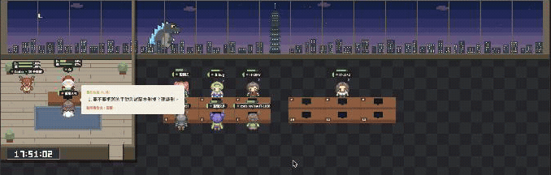

# Session Office

[English](README.md)



給 Claude Code session 用的像素辦公室。每個在跑的 session 是辦公室裡的一位同事，坐在自己的桌子前；做完一輪就走到你桌前匯報。在頁面上可以回覆、按收到、`/clear`、`/compact`、幫它改名、開除它，或開一個新 session。

## 運作方式

```
session ─(office mod)→ ~/.claude/office/desks/<id>.json
                                   │
              bridge session（只有一個，在自己的 iTerm2 分頁）
                                   │ ArtifactData
                                   ▼
                    Session Office 頁面（claude.ai artifact）
```

- **mod/**：Claude Code 的 mod。每個 session 把自己的桌卡寫成本機檔案；工作中的 session 不會呼叫任何工具，所以你用什麼權限模式都不受影響。
- **bridge**：用 `CLAUDE_OFFICE_BRIDGE=1` 啟動的一個 session，負責把桌卡同步進頁面的資料庫，再把頁面上下的指令寫回檔案給各 session。它以 `--dangerously-skip-permissions` 執行（寫入 artifact 資料的同意沒有其他方式能預先允許），所以**不要在 bridge 分頁裡交辦任何工作**。頁面右上角的燈號顯示它最後一次同步的時間，斷線時會轉紅；斷的是你自己的網路時會直接寫明，網路回來頁面會自己接上。
- **page/**：artifact 頁面本身。
- **install/**：讓 bridge 保持運作的 watchdog、它的 LaunchAgent，以及 `office-hook.sh`：安裝程式會把兩個 hook 加進 `~/.claude/settings.json`（旁邊留一份備份），在 session 等權限確認時通知頁面，以及回合結束時告訴頁面還有哪些背景工作在跑；mod 自己的這種 hook 可能被其他外掛擋掉。

## 使用手冊

以截圖為主的操作手冊：<https://jacobintern.github.io/session-office/manual/>（GitHub Pages，原始檔在 [docs/manual/](docs/manual/)，推上 main 幾分鐘後就會更新）。

## Token 用量

每月不到 US$1，不是燒 token 的工具：同步和桌卡都由 mod 直接處理，不經過模型；只有每次提問附上的匯報格式說明（約 130 token）會花 token。細節見 [docs/token-cost.md](docs/token-cost.md)。

## 行前準備

| | 必要 | 要錢嗎 | 怎麼確認 |
|---|---|---|---|
| macOS + [iTerm2](https://iterm2.com) | 是 | 免費 | bridge 跑在 iTerm2 分頁裡，由 launchd 維持運作 |
| 含 Claude Code 的 claude.ai 方案：Pro、Max、Ultra、Team 或 Enterprise | 是 | **付費**。Free 方案沒有 Claude Code、沒有 artifact 資料庫（`db`）、也不能從 Claude Code 發佈 | `claude --version`（2.1.311 測試過） |
| Pipoya 人物素材包 + node | 是，只需一次 | 免費（素材包不可轉散布） | 見〈人物圖〉 |
| Jira Cloud API token | 否 | 你自己的 Jira 帳號 | Jira 欄位才需要 |
| Codex CLI | 否 | 你自己的 ChatGPT 方案（要含 Codex） | Codex 秘書才需要 |

跑起來每月在你的方案裡花不到 US$1（見〈Token 用量〉）；英文小老師用的是打開頁面那個人自己的額度，不是發佈者的。

`install/install.sh --check` 會逐項檢查上面這些（以及 bridge），失敗的項目會附上修法。

## 安裝

1. 取得 repository 並安裝 mod：

   ```sh
   git clone git@github.com:jacobintern/session-office.git && cd session-office
   claude plugin marketplace add jacobintern/session-office
   claude plugin install office@session-office
   ```

2. 產生人物圖（見〈人物圖〉）：

   ```sh
   node install/build-sprites.mjs ~/Downloads/"PIPOYA FREE RPG Character Sprites 32x32.zip"
   ```

3. 發佈你自己的頁面。每個人都要有自己的一份，因為頁面的資料庫存的是你的 session。在這個資料夾開一個 Claude Code session，貼上：

   > Publish `page/session-office.html` as a new artifact with the `db`,
   > `user` and `sample` capabilities, and publish every file in `page/chars/` alongside it
   > at `chars/<file name>`. Give me the artifact's URL.

4. 執行安裝程式，再把網址填進設定檔：

   ```sh
   ./install/install.sh          # --no-launchd 不裝 LaunchAgent，--uninstall 移除
   $EDITOR ~/.claude/office/config.json
   ```

5. 等 bridge 起來（不用自己開）。一分鐘內 watchdog 會開一個 iTerm2 分頁跑 bridge。第一次會有三個確認，全部按完 bridge 才會開始運作：
   - macOS：允許 watchdog 控制 iTerm2（自動化權限）；
   - Claude Code：接受 `--dangerously-skip-permissions`；
   - Claude Code：信任 bridge 的資料夾（`bridgeCwd`）。

   之後 watchdog 會自己把 bridge 顧好：iTerm2 沒開（例如重開機後）會先把它開起來；bridge 超過 3 分鐘沒同步（卡在確認視窗）會把它換掉。

6. 檢查：在終端機跑 `./install/install.sh --check`，或在任一個 session 打 `/office doctor`。接著開一個新的 `claude` session，它就會出現在頁面的桌子上。

## 更新

`git pull` 之後，三個部分各自更新：

| 改了什麼 | 怎麼更新 |
|---|---|
| `mod/`（office mod） | `claude plugin update office@session-office`，再重開 session 和 bridge 分頁（關掉分頁，watchdog 一分鐘內會重開）。如果你用 `CLAUDE_CODE_PLUGIN_DIRS` 指向這個 repo 的 `mod/`，只要重開 session |
| `page/`（頁面） | 在這個資料夾開 session，請它把 `page/session-office.html` 發佈到你原本的網址（`officeUrl`），資料庫和角色圖都會保留 |
| `install/`（watchdog、hook） | 再跑一次 `./install/install.sh`，既有的 `config.json` 不會被覆蓋 |

## 指令

| | |
|---|---|
| `/office` | 頁面網址、這個 session 的桌卡，以及設定檢查是否全部通過 |
| `/office doctor` | 檢查設定、這個 session 的桌卡、bridge，以及這個 mod 的 hook 有沒有跑到（更高層的 plugin 可能跳過它） |
| `/office name <文字>` | 設定桌牌（留空就清掉），session 標題會跟著換（它會執行 `/rename`；你自己打 `/rename` 桌牌也會跟著換）。也可以在頁面的回覆框打，或直接叫 session 自己改名 |
| `/office project <文字>` | 這張桌子屬於哪個專案／話題（留空改回分支票號或 repo），同專案的 session 共用公佈欄。頁面「專案」列旁的 ✎ 也能改 |
| `/office status` | bridge 最近一輪的狀況 |
| `/office bridge` / `/office bridge off` | 讓這個 session 當 bridge，或取消 |

每個 session 啟動 15 秒後會跑一次同樣的檢查，只有失敗時才跳出一行提示。

## 設定：`~/.claude/office/config.json`

| 欄位 | 意義 |
|---|---|
| `officeUrl` | 你發佈的頁面網址 |
| `bridgeCwd` | bridge session 執行的資料夾 |
| `jira` | `null`，或 `{ "site", "email", "jql"?, "tokenFile"? }`。token 從 `tokenFile`（預設 `~/.jira_api_token`）讀取，透過 stdin 交給 curl，不會出現在指令參數裡；沒設 `jira` 時 Jira 欄位會隱藏 |
| `codex` | 設成 `false` 會隱藏 Codex 秘書 |
| `tutor` | 設成 `false` 會隱藏英文小老師 |
| `analyst` | 設成 `false` 會隱藏用量分析師 |
| `city` | `{ "lat", "lng" }`，用來計算窗外的日出日落 |
| `newSessionDirs` | 從頁面開新 session 時可選的資料夾 |
| `language` | `"zh-TW"`（預設）或 `"en"`：session 列出待決事項時用的標題（`## 要你決定` / `## Decisions for you`）。頁面本身跟隨瀏覽器語言，右上角可以切換中 / EN |

只有 `jira.site`、`codex`、`tutor`、`analyst`、`city`、`newSessionDirs` 會送到頁面（存在 `meta/config`）；Jira 的 email 和 token 只留在你的電腦上。

## 人物圖

角色來自 Pipoya 的免費素材包 **PIPOYA FREE RPG Character Sprites 32x32**（https://pipoya.itch.io/pipoya-free-rpg-character-sprites-32x32）。它的授權允許使用和修改，但不允許轉散布，所以圖片不放在這個 repository 裡。請從上面的連結下載素材包（免費），再用 `install/build-sprites.mjs` 產生頁面用的人物圖（〈安裝〉第 2 步）。產出會寫到 `page/chars/`（你、Codex 秘書和四組角色），要跟頁面一起發佈。

## 英文小老師

坐在你辦公室外左下、有自己桌子的老師會把你貼上的文字逐段翻譯，原文和譯文對照列出：中文翻成英文，其他翻成繁體中文。對翻譯有疑問、或想知道某句話英文怎麼說，按「問老師」。她是從頁面直接問 Claude（`sample` 權限，用你自己的 claude.ai 用量），所以不需要橋接視窗；第一次用時 claude.ai 會問你要不要允許。

## 用量分析師

點你自己會看到 5 小時和一週額度還剩多少、各自什麼時候重置。英文小老師隔壁桌的分析師看得更多：她用橋接視窗記的用量歷史（`meta/usage`，每分鐘一筆、保留 8 天），照最近的消耗速度預估每個額度什麼時候用完、列出在線上的 session 依花費排行，也能回答相關問題（跟小老師一樣從頁面問 Claude）。

## 匯報格式

mod 會在每次送出的提問附上一行說明，要求模型需要你決定時，在回答最後加一段 `## 要你決定`；頁面會把這一段顯示成醒目的區塊。

## 授權

repository 裡的程式碼採 MIT 授權。人物圖屬於 Pipoya，依 Pipoya 自己的條款使用。
